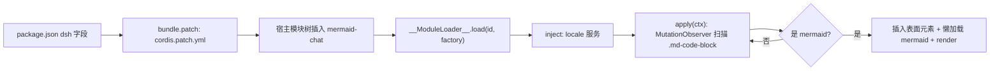

# AGENTS.md — dsh-mermaid-plugin

> 本文件面向在本仓库工作的 AI Agent 与开发者，描述项目定位、结构、机制与开发/验证约定。

## 项目概述

- **插件名**：`@local/mermaid-chat`（v1.0.0，private，ESM）
- **定位**：DeepSeek Harness（DSH）Web 端客户端插件，把聊天消息中的 ` ```mermaid ` 代码块直接渲染为图形
- **核心能力**：
  - 自动识别会话中的 mermaid 代码块并渲染为 SVG 图形
  - 图形 / 源码双模式切换（header 上的按钮）
  - 跟随 DSH 深浅色主题自动重渲染
  - 渲染失败时保留源码并显示错误信息（不吞内容）
- **形态**：纯前端插件，无后端交互、无 npm 依赖、无构建脚本、无测试框架

## 仓库结构

| 文件 | 性质 | 说明 |
| --- | --- | --- |
| `package.json` | 手写 | 插件清单：exports 映射、`dsh.bundle.patch`、`dsh.client` 加载配置 |
| `index.js` | 手写 | 宿主半边入口，仅一个空 `apply()`（渲染逻辑全在 client 侧），保持原样 |
| `client.js` | 预构建 + 手写插件逻辑（约 3.4 MB） | mermaid 11.17.2 全量 bundle（含 dayjs / dompurify / katex）+ 文件末尾的插件自身逻辑（`__ModuleLoader__.load` 注册段）；当前仓库即维护入口 |
| `cordis.patch.yml` | 手写 | bundle 补丁：向宿主模块树插入 `id: mermaid-chat` / `name: '@local/mermaid-chat'` |
| `locale/zh.json`、`locale/en.json` | 手写 | 插件元信息（标题/描述），用于插件列表展示 |
| `icon.svg` | 手写 | 插件图标 |

> 仓库同级目录存在 `dsh-mermaid-plugin.zip`，为打包分发产物。
> git 仓库已提交到 master，origin 为 `github.com/shinelon/dsh-mermaid-plugin`。

## 架构与加载机制



- **加载链路**：DSH 读取 `package.json` 的 `dsh` 字段 → `dsh.bundle.patch` 指向 `cordis.patch.yml`，把模块插入宿主 bundle → 前端 `window.__ModuleLoader__.load({id, factory})` 注册模块，factory 返回 `{inject: ["locale"], apply(ctx)}`。
- **client 配置**（`dsh.client`）：
  - `platform: "web"` — 仅 Web 端
  - `immediately: true` — 页面加载即执行，非懒加载
  - `inject: ["@deepseek-ai/dsh-client-ui-conversation"]` — 依赖会话 UI 的 DOM 结构与 `locale` 服务

## client.js 插件逻辑速查（修改前必读）

插件自身逻辑全部位于 client.js 文件末尾的 `__ModuleLoader__.load(...)` 段（bundle 内其余部分为 mermaid 及其依赖，勿动）。

### 关键选择器与常量

| 标识 | 值/含义 |
| --- | --- |
| 宿主代码块 | `.md-code-block` |
| 语言横幅 | `[data-code-block-banner]`（首子元素文本为 `mermaid` 即判定） |
| 代码内容 | `[data-code-block-content]` |
| 表面元素 | `[data-mermaid-chat-surface]`（插件插入的容器，含 `data-mode` / `data-render` 状态） |
| 样式注入 | `<style data-plugin="@local/mermaid-chat">`，使用 DSH Web 别名变量 `--dsw-alias-*`、`--dsw-radius-*` |

### mermaid 判定规则

横幅判定，或对源码做正则判定：跳过前导空行、`%%` 注释行和 `---` frontmatter 后，测首个有效行（大小写不敏感）。当前支持：
`flowchart`、`graph TB/TD/BT/RL/LR`（graph 必须带方向）、`sequenceDiagram`、`classDiagram`、`stateDiagram(-v2)`、`erDiagram`、`journey`、`gantt`、`pie`、`mindmap`、`timeline`、`gitGraph`、`quadrantChart`、`requirementDiagram`、`c4Context`、`sankey-beta`、`xychart-beta`、`block-beta`、`packet-beta`、`architecture-beta`。

### 渲染与状态

- **扫描**：`MutationObserver` 监听 `document.body`（childList/subtree/characterData + `data-streaming` 属性），350ms 定时后增量扫描；代码块若处于 `[data-streaming]` 祖先内（assistant 消息仍在流式），跳过创建表面与渲染，消息结束后一次性出图。
- **增量复用**：`WeakMap`（surface → 状态对象）+ `lastCode` 去重，代码未变化不重渲染；宿主代码块被移除时同步清理对应表面。
- **懒加载**：mermaid 模块 Promise 缓存，首次渲染时才初始化（`startOnLoad: false`、`securityLevel: "strict"`、`htmlLabels: false`、`secure` 锁定 `htmlLabels` / `themeCSS` / `fontFamily`、`theme` 按当前主题、透明背景、`useMaxWidth`）。
- **失败回退**：渲染异常时 `data-render="error"`，显示「渲染失败 + 错误详情」，源码块保持可见。
- **切换逻辑**：仅 `data-mode="diagram"` 且 `data-render="ok"` 时用 CSS `:has()` 隐藏宿主源码块；从错误状态切回「图形」会强制重渲染一次。
- **交互收紧**：表面元素在捕获阶段拦截 `click` / `submit`：图内 http(s) 链接走 `window.open(..., "noopener,noreferrer")`，不替换当前标签页；表单提交一律阻止。

### 主题与 i18n

- **主题**：第二个 `MutationObserver` 监听 `body[data-ds-dark-theme]` 属性 → 重新 `mermaid.initialize({theme: "dark" | "default"})` 并强制重渲染所有表面。
- **i18n**：优先走注入的 `locale` 服务 `t()`，失败/缺失时回退到内置 zh/en 字典（bundle 内 `cw` 变量）；`locale.subscribe` 负责已渲染文案的刷新。

### 生命周期

`ctx.effect(...)` 注册清理：置 disposed 标志停止后续渲染 → 断开两个 observer 与防抖定时器 → 移除注入的 style 与所有表面元素。**所有异步渲染回调都必须先检查 disposed 标志**，新增异步逻辑时同样遵守。

## 开发约定

- **client.js 以预构建 bundle 入库，插件逻辑在文件末尾注册段；当前仓库即插件维护入口**。修改时只动注册段，保持现有 IIFE/压缩风格，不要格式化或整体重构 bundle；若后续恢复源工程/构建脚本，优先回源构建后替换本文件。
- `index.js` 的空 `apply()` 是宿主半边协议，保持原样。
- `package.json` 的 `exports` 与 `files` 必须和实际文件严格同步，新增/重命名文件时两处一起改。
- 界面文案改 `client.js` 内置字典（`cw`），插件列表标题/描述改 `locale/*.json`，两处职责不同不要混用。
- 无 npm 依赖、无 lockfile，**不需要也不存在 install 步骤**；除非用户明确要求，不要引入构建工具链或依赖。

## 验证（完成前必做）

- **静态检查**（本仓库唯一可自动化手段）：

  ```bash
  node --check index.js && node --check client.js
  ```

- **手动验证**（DSH Web GUI，改 client.js 后需重载会话页面）：
  1. 聊天中让模型输出 mermaid 代码块 → 确认自动渲染成功；
  2. 「图形 / 源码」来回切换 → 确认宿主源码块显隐正确；
  3. 切换 DSH 深浅主题 → 确认图形重渲染且配色跟随；
  4. 故意写非法 mermaid 语法 → 确认回退源码并显示错误信息；
  5. 流式输出 mermaid 代码块 → 确认消息流式期间只显示源码、不出现解析错误，消息结束后一次性出图；
  6. 关闭/重开会话 → 确认无残留表面元素。
- 无 lint / test 脚本；声称「验证通过」前必须实际执行上述检查并确认输出。
